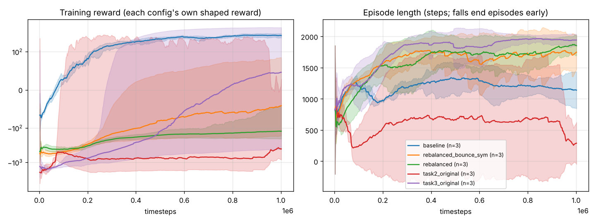

# Reinforcement Learning Bipedal Walker: PPO Locomotion & Reward Shaping

Training a 2D bipedal robot to walk with PPO (Stable-Baselines3), and measuring how reward shaping changes whether, how fast, and how smoothly it walks.

Started as a university assignment (UCD COMP47590). The course provided the environment (`bipedal_walker_ucd.py`, a lightly modified Gymnasium `BipedalWalker`), the PPO hyper-parameters and four shaping terms (energy, stability, smoothness, target speed). **My additions:** the `bounce` and `leg_symmetry` reward terms, the diagnosis of why the original Task 2 reward failed, and the multi-seed training and evaluation harness (`train.py`, `evaluate.py`) behind the results below.

## Results

Every configuration was trained for **1M steps with 3 seeds**, then evaluated with the deterministic policy on the **same 20 seeded terrains** with a 5,000-step limit. Training episodes were capped at 2,000 steps; the longer evaluation limit lets the slower, shaped gaits finish. With a 2,000-step limit (`results/eval_results.json`, 50 terrains), the shaped configs rarely finish in time but still rarely fall. Values are the mean over seeds; the per-seed success rates are shown in brackets.

| Reward config | Finished course | Fell | Course covered | Median steps to finish | Jerk ↓ | Hull tilt ↓ (rad) | Official v3 score* |
|---|---|---|---|---|---|---|---|
| Random actions | 0% | 68% | 1.5% | n/a | 0.66 | 0.45 | −107 |
| **Baseline** (progress only) | **93%** [100, 85, 95] | 7% | 97% | **1,092** | 0.25 | 0.45 | **239** |
| Task 2 weights (energy 3.0, stability 1.5, smooth 0.3, speed 0.5) | **0%** [0, 0, 0] | 78% | 5% | n/a | 0.04 | 0.11 | −149 |
| Task 3 weights (adds my bounce 0.4 + leg-symmetry 0.5) | **95%** [100, 100, 85] | 3% | 97% | 2,829 | **0.08** | 0.25 | 129 |
| Rebalanced (energy 1.0, stability 0.5, smooth 0.1) | 63% [95, 95, 0] | 2% | 65% | 2,335 | 0.04 | 0.10 | −61 |
| Rebalanced + bounce 0.1 + leg-symmetry 0.1 | 62% [100, 85, 0] | 12% | 91% | 2,147 | 0.06 | 0.18 | 27 |

\* The same episode re-scored with the official `BipedalWalker-v3` reward, which also charges for motor energy. 300 counts as "solved"; no configuration here reaches it.
"Jerk" is the mean |aₜ − aₜ₋₁| per step (lower = smoother); "hull tilt" is the mean |hull angle| (lower = more upright).



### Findings

1. **The baseline walks, fast but roughly.** It finishes 93% of runs in about 1,100 steps, but with the highest jerk and tilt of any agent that walks: a lurching "kick and fall forward" gait.
2. **The original Task 2 reward makes falling the best strategy.** Its per-step penalties cost about −1 per step even when standing still (the speed term alone is −0.5 × |0 − 1.5| = −0.75). Over a long episode that adds up to about −5,000, while falling costs only −100. All 3 seeds learned to fall early: 0% finished and 78% fell, (seed 0's training episodes averaged only 66–82 steps). The original notebook's training log shows the same trend (reward went from −383 to −5,460).
3. **With my bounce and leg-symmetry terms, the gait is smoother but slower.** With the Task 3 weights, success matches the baseline (95% vs 93%, across seeds), jerk drops by **3×** (0.08 vs 0.25), hull tilt drops by **43%**, and the official v3 score falls from 239 to 129. The cost is speed: the course takes **2.6× as long** (2,829 vs 1,092 steps). Smoothness was bought with speed.
4. **Shaped rewards are much less reliable across seeds.** In both "rebalanced" configs, one of the three seeds never finishes (0% success). The baseline gives 85–100% on every seed. A single run would have hidden this.
5. **Evaluation mode matters.** The notebook's original Task 1 agent finishes 44% of runs when it samples actions (the way it was trained) but only 6% with deterministic actions (`results/eval_results.json`). The re-trained baseline does not have this gap (93% deterministic), but I have not isolated which change caused the difference.

### Corrections to the notebook

The reflections in the notebook were written from watching single evaluation videos, and some of their claims are wrong:
- The committed `agents/Task2_Smooth_Gait.zip` is **untrained** (`num_timesteps = 0`).
- The Task 2 run did not reach "~280 base reward". It got worse throughout training.
- The Task 3 agent was never saved.

The table above, from re-trained agents in `agents/runs/`, replaces those claims.

## Project structure
* `bipedal_walker_ucd.py`: course-provided environment (Gymnasium `BipedalWalker` without the energy and head-angle terms in the reward).
* `rewards.py`: reward-shaping wrapper (course terms plus my `bounce` / `leg_symmetry`).
* `train.py`: trains one config and seed; learning curves go to `logs/<run>/progress.csv`.
* `evaluate.py`: seeded evaluation (success, falls, distance, base and v3 score, energy, jerk, tilt).
* `plot_curves.py`: plots `results/training_curves.png`.
* `agents/runs/`: the 15 re-trained agents (5 configs × 3 seeds).
* `results/`: evaluation JSON files and plots.
* `COMP47590 Assignment 2 Going The Distance Template v4.ipynb`: the original assignment notebook.
* `eval_videos/`: evaluation videos recorded during the original Task 1 training run.

## Reproducing

```bash
pip install "gymnasium[box2d]" stable-baselines3 torch matplotlib pandas

# train all 15 runs (about 1,000 steps/s per process on CPU)
for c in baseline task2_original task3_original rebalanced rebalanced_bounce_sym; do
  for s in 0 1 2; do python train.py --config $c --seed $s --steps 1000000; done
done

python evaluate.py --episodes 20 --max-steps 5000 --out results/eval_results_5000steps.json
python plot_curves.py
```
